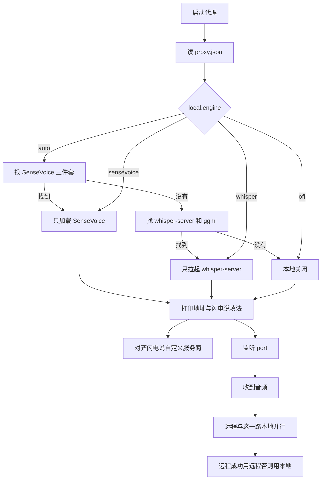
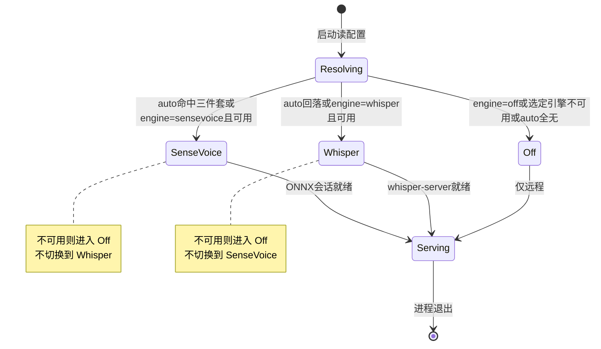

# PRD: 本地兜底二选一（SenseVoice / Whisper）

| 属性 | 内容 |
|------|------|
| 状态 | 工程：`accepted`（关闭；见文末「工程验收状态」） |
| 范围 | 本仓代理进程：本地引擎选择、启动探测、配置落盘、闪电说自定义服务商对齐与启动说明；豆包远程协议沿用 prd-00001 |
| 关联 | `docs/workflows/asr-proxy.md`；`configs/proxy.json`；`configs/premium.json`；`specs/prds/prd-00001-dual-write.md`；入口 `scripts/whisper_openai_asr_proxy.py` |

## 背景与问题

闪电说经自定义服务商打到本仓代理。当前本地兜底固定走本机 whisper.cpp（`whisper-server` + ggml）。分发场景下，对方往往已安装闪电说并下载了 SenseVoice Small（`model.onnx`），却未必编译过 whisper.cpp。探测已证明：直接加载闪电说目录中的 `model.onnx` 可转写出与闪电说速度测试一致的文本；闪电说进程**不**对外暴露可调用的识别端口，无法借用其进程内内存。

需要把本地兜底改成**可配置的二选一**：SenseVoice 或 Whisper，同一时刻只加载一路；远程豆包规则不变。启动时尽量自动找到模型目录，并向用户汇报如何在闪电说里填 Chat 音频服务商（能写则写 `config.json`，同时打印说明）。

## 目标与非目标

### 目标

- 每次请求仍是**远程 + 一路本地**并行；远程成功用远程文本，远程失败用本地文本（规则同 prd-00001）。
- 本地引擎互斥：`sensevoice` 与 `whisper` 不同时加载；由 `configs/proxy.json` 的 `local.engine` 控制（`auto` | `sensevoice` | `whisper` | `off`）。
- `auto`：优先探测闪电说 SenseVoice 三件套；否则探测 Whisper 可执行文件与 ggml；都没有则本地关闭，进程仍监听，仅远程。
- 启动时探测默认路径；可选覆盖路径写在配置里，用户尽量不用手填。
- 启动时把探测结果写回 `configs/proxy.json`（未手写锁定时）；对齐闪电说 `config.json` 中自定义服务商，并打印 Chat 音频填法（URL、Key、模型）。
- SenseVoice **不另开**对外端口；仅 Whisper 需要内部 `port+1`。

### 非目标

- 把 894MB（或量化版）`model.onnx` 打进本仓或随包分发。
- 调用闪电说进程内已加载的模型内存或进程内 IPC/HTTP 识别接口。
- 同一请求并行跑 SenseVoice 与 Whisper。
- 改豆包 SAUC 协议、密钥进 `configs/`、或改对外 Chat Completions 形状。
- 为 SenseVoice 再开一个让用户在闪电说里填写的第二端口。
- 改造闪电说客户端源码；本仓只读写其本机 `config.json`（尽力而为）。

## 术语

| 术语 | 含义 |
|------|------|
| 远程 / 高级模型 | 配置在 `configs/premium.json` 的云端 ASR（当前豆包）；密钥仅环境变量 |
| 本地兜底 | 远程失败时返回的本机转写结果；本 PRD 中同一时刻只启用一路引擎 |
| SenseVoice | 闪电说本地下载的 FunASR SenseVoice Small ONNX（`model.onnx` + `tokens.json` + `config.yaml`） |
| Whisper | 本机 whisper.cpp 的 `whisper-server` + `ggml-*.bin` |
| 三件套 | SenseVoice 目录内同时存在 `model.onnx`、`tokens.json`、`config.yaml` |
| Chat 音频 | 闪电说自定义服务商协议 `chat_audio_data_url`（界面「Chat 音频」） |
| `local.engine` | `proxy.json` 中本地引擎选择字段 |

## 已拍板规则

| 项 | 决定 |
|----|------|
| 对外协议 | 仍为 `POST /v1/chat/completions` + `input_audio` WAV；地址 `http://127.0.0.1:<port>/v1` |
| 选用文本 | 远程成功 → 远程；远程失败 → 本地；两路都失败 → 502；远程空文本仍视为有效（同 prd-00001） |
| 本地互斥 | 禁止 SenseVoice 与 Whisper 同时加载 |
| `local.engine` | `auto` \| `sensevoice` \| `whisper` \| `off`；默认 `auto`；无密钥 |
| `auto` 优先级 | SenseVoice 三件套可用 → SenseVoice；否则 Whisper 二进制+模型可用 → Whisper；否则本地关闭 |
| 显式引擎 | 用户写成 `sensevoice` / `whisper` 后固定该路；该路不可用则**跳过本地**，不偷偷切到另一路 |
| SenseVoice 端口 | 不另开；在代理进程内用 ONNX Runtime 推理 |
| Whisper 端口 | 仍仅内部 `port+1`，不写进闪电说配置 |
| 配置落盘 | 行为配置进 `configs/proxy.json`；豆包密钥仍 `.env` / `DOUBAO_ASR_API_KEY` |
| 探测写回 | 启动探测后写入实际引擎名与找到的 `sensevoice.model_dir`（若适用）；用户已手写非 `auto` 的引擎名不覆盖 |
| 闪电说配置 | 能写则写：`protocol=chat_audio_data_url`，`endpoint=http://127.0.0.1:<port>/v1`，`model`/`models` 保持或设为 `medium`，`enabled=true`，`asr.provider` 指向该条；已有 `api_key` 保留，没有则占位 `local`；已有同形状条目只对齐地址，不另造一条 |
| 启动说明 | 控制台打印 Chat 音频填法（接入方式、Base URL、API Key 说明、模型、本次本地引擎）；不打印豆包密钥；说明写入 `docs/workflows/asr-proxy.md`（实现时） |
| 量化模型 | 仍使用同路径下的 `model.onnx` 文件名（用户按闪电说帮助文档替换量化文件） |

## 用户与角色

| 角色 | 目标 |
|------|------|
| 分发接收方 | 已装闪电说；启动代理后尽量零路径配置即可用远程+本地兜底 |
| 本机开发者 / 运维 | 可在 `proxy.json` 固定引擎、覆盖模型目录、核对日志 |
| 闪电说用户 | 在自定义服务商里用 Chat 音频连上本代理；刷新设置可见已对齐项 |

## 功能域

### F1 本地引擎选择与探测

- 读 `local.engine`；`auto` 按优先级探测；显式值校验文件存在性。
- SenseVoice 候选目录（命中三件套即停）：
  - 可选覆盖：`local.sensevoice.model_dir`（或等价字段名，实现时定）
  - macOS：`~/Library/Application Support/Shandianshuo/workspace/models/sensevoice-small`
  - Windows：`%APPDATA%\Shandianshuo\workspace\models\sensevoice-small`，其次 `%APPDATA%\cn.shandianshuo.desktop\workspace\models\sensevoice-small`
- Whisper：沿用现有 `whisper.root` / `bin` / `models_dir` / `model`；文件不齐则该路不可用。
- 启动日志标明选用引擎或「本地关闭」。

### F2 运行时加载

- SenseVoice：进程内加载 ONNX；依赖 `onnxruntime`、`kaldi-native-fbank`（实现阶段写入环境说明）。
- Whisper：仅在选中时 `Popen` `whisper-server`（与现入口一致）。
- 未选中的引擎不占内存、不占内部端口。

### F3 双写路由

- 复用 `run_dual`：远程与**当前**本地转写函数并行；本地关闭时行为等价于仅远程（本地结果视为失败/跳过，选用规则与日志字段在实现时对齐现有日志约定）。

### F4 闪电说配置对齐与说明

- 探测本机闪电说 `config.json`（与模型目录同应用支持根下）：
  - macOS：`~/Library/Application Support/Shandianshuo/config.json`
  - Windows：上述 APPDATA 候选根下的 `config.json`
- 写入/对齐自定义服务商字段（见已拍板表）；闪电说若正运行可能覆盖文件——说明要求用户刷新设置，对不上则按打印四项手填。
- 控制台横幅含：Base URL、请求预览 `.../v1/chat/completions`、Key 说明、模型 `medium`、本地引擎名。

### F5 配置与文档

- 扩展 `configs/proxy.json` 出厂默认：`local.engine=auto` 及 SenseVoice 可选字段。
- 更新 `docs/workflows/asr-proxy.md`：启动步骤、引擎选择、闪电说填法、Windows/Mac 路径。
- 登记依赖变更（若实现引入 pip 包，按 AGENTS：安装命令给用户手动执行）。

## 用户故事地图与版本切片

### 旅程主干

| 步骤 | Entry / 动作 | Exit |
|------|----------------|------|
| 1 | 用户安装闪电说并（可选）下载 SenseVoice；可选配置 `.env` 豆包密钥 | 本机有或无模型文件 |
| 2 | 无参启动代理 | 日志出现对外地址与本地引擎结论 |
| 3 | 代理探测引擎并尽力写回 `proxy.json`、对齐闪电说 `config.json` | 配置已写或打印手填说明 |
| 4 | 用户在闪电说刷新设置 / 确认自定义服务商为 Chat 音频 | 可发听写 |
| 5 | 用户听写；请求到达代理 | 远程与一路本地并行 |
| 6 | 远程成功或失败回落 | 闪电说收到文本；失败则 502 |
| 7 | 用户 Ctrl+C 停止 | 子进程（若有 whisper-server）退出；SenseVoice 会话释放 |

### 用户故事地图

**阶段 A — 启动与探测**

| 故事 | 验收要点 |
|------|----------|
| 作为分发接收方，我想启动后自动选本地引擎，以便不必先懂 whisper 路径 | `auto` 下有三件套则日志为 SenseVoice，且未启动 whisper-server |
| 作为仅有 Whisper 的用户，我想自动落到 Whisper，以便仍有本地兜底 | 无三件套但 whisper 文件齐全时日志为 Whisper，并监听 `port+1` |
| 作为两边都没有的用户，我想代理仍能启动，以便只用远程 | 本地关闭；进程监听 `port`；无密钥时行为与现网一致可测 |

**阶段 B — 配置互斥**

| 故事 | 验收要点 |
|------|----------|
| 作为运维，我想把 `local.engine` 设为 `sensevoice`，以便固定引擎 | 不加载 Whisper；三件套缺失则本地跳过、不改切 Whisper |
| 作为运维，我想设为 `whisper` 或 `off`，以便关闭 SenseVoice 或全部本地 | `whisper` 不加载 ONNX；`off` 不跑本地转写 |

**阶段 C — 闪电说对接**

| 故事 | 验收要点 |
|------|----------|
| 作为用户，我想启动日志告诉我 Chat 音频怎么填，以便对着设置页操作 | 打印 Base URL、`chat/completions` 预览、模型 `medium`、Key 说明 |
| 作为用户，我想代理尽量写好闪电说配置，以便刷新即可用 | `config.json` 中有 `chat_audio_data_url` 项且 `endpoint` 对齐当前 `port`；已有 Key 不被清空 |

**阶段 D — 双写行为**

| 故事 | 验收要点 |
|------|----------|
| 作为听写用户，我想远程失败时仍有本地结果，以便断网可用 | 与 prd-00001 相同选用规则；日志可区分本地引擎种类 |

### Release 切片

#### Release 0（MVP）

- `local.engine` 四态 + `auto` 探测优先级；SenseVoice 进程内推理；Whisper 仅在选中时启动。
- 启动写回探测结果；打印闪电说填法；尽力对齐 `config.json`。
- 文档更新启动与配置说明。
- **可验收结果**：仅 SenseVoice 环境不启 whisper-server；仅 Whisper 不加载 ONNX；双有时 `auto` 选 SenseVoice；无本地可启动；闪电说可按打印项或自动配置连通。

#### Release 1（同 PRD 增强，可选）

- Windows 候选路径在真实 Windows 机上核对并修正顺序/额外候选。
- 探测写回字段的更细粒度（例如上次探测时间、跳过原因码）便于排障。
- **本期不做**：GUI 配置器、自动下载 SenseVoice/Whisper 模型、多本地引擎负载均衡。

## 核心流程与状态机图

### 启动与请求主流程

### 本地引擎状态机

## 数据与 API 衔接

| 接口 / 文件 | 说明 |
|-------------|------|
| `POST /v1/chat/completions` | 对外不变；闪电说 Chat 音频 |
| 内部 `port+1` | 仅 Whisper 引擎启用时存在 |
| `configs/proxy.json` | 增加 `local`（引擎、可选 `sensevoice.model_dir`）；保留现有 `whisper` 块 |
| `configs/premium.json` | 不变 |
| 闪电说 `config.json` → `asr.custom_providers[]` | `protocol=chat_audio_data_url`；`endpoint`；`model`/`models`；`api_key`；`enabled`；`asr.provider` |
| SenseVoice 目录 | 三件套；输入张量名 `speech` / `speech_lengths` / `language` / `textnorm`（实现参考 FunASR ONNX 契约；探测已验证） |

## 假设与开放项

| ID | 内容 |
|----|------|
| A1 | Windows 正式路径以 APPDATA 两候选为准；若真实安装目录不同，R1 修正 |
| A2 | 闪电说正在运行时写 `config.json` 可能被其保存覆盖；用户刷新/手填为兜底 |
| A3 | 代理进程加载 SenseVoice 与闪电说 UI 内加载可能各占一份内存；分发说明建议日常听写用自定义服务商、不必同时开 SenseVoice 速度测试 |
| O1 | `proxy.json` 中 `local` 字段精确 JSON 形状由实现定稿，须满足本 PRD 语义 |
| O2 | 标准库-only 现状与 ONNX 依赖的取舍：实现阶段明确是否引入 pip 依赖及用户安装命令 |
| O3 | 本地关闭时 `run_dual` / 日志字段是否需要新的 `chosen` 取值，与现有测试对齐 |

## 成功标准（度量）

1. `auto` + 仅三件套：零次启动 `whisper-server`，本地转写成功至少 1 条已知测试句。
2. `auto` + 仅 Whisper：零次加载 `model.onnx`，本地转写成功至少 1 条。
3. `auto` + 两者皆有：选用 SenseVoice。
4. 无本地文件：进程退出码非「配置致命」即可启动并响应远程（或无密钥时仅本地失败路径可测）。
5. 启动输出含可复制的 Base URL 与 Chat 音频填法；在可写环境下 `config.json` 出现对齐后的自定义服务商。

## 依赖与风险

| 依赖 / 风险 | 缓解 |
|-------------|------|
| ONNX Runtime 与 fbank 依赖 | 文档给出安装命令；探测失败则本地关闭 |
| 闪电说配置格式变更 | 写入失败只打日志 + 打印手填；不阻断启动 |
| 大模型内存 | 默认不双载；文档提示量化 `model.onnx` |
| Windows 路径猜错 | 候选列表 + 可选覆盖字段 |

## 修订记录

| 日期 | 说明 |
|------|------|
| 2026-11-18 | 新建 backlog：本地兜底二选一、探测路径、闪电说配置对齐与说明；探测结论写入非目标与假设 |
| 2026-11-18 | 实现落地；闪电说配置改为稳定 ID / 唯一认领，避免每次启动新建；工程验收 accepted |
| 2026-11-18 | 依赖改为 `uv sync`；Rich 启动摘要（运行状态 + 闪电说四项）；README；工程验收关闭确认 |

## 1. 工程验收状态

> 由 `/team:prd-accept` 维护；勿手工编造「通过」。最后更新：2026-11-18T02:15:51Z，feat/prd-00002-local-fallback@d469b24（工作区含 UV/Rich/README 未提交变更），范围：R0,R1。

### 总览

- 工程状态：`accepted`（关闭）
- 验收判定：通过（R0 无未实现；R1 Windows 实机仍遗留）
- 最近验收：本轮对照实现复验 + 单测 39；`auto` 本机解析为 sensevoice
- 摘要：
  - `local.engine` 四态；SenseVoice / Whisper 互斥；默认对外 18888
  - 依赖：`pyproject.toml` + `uv sync`（启动不自动联网装包）
  - 闪电说配置：稳定 ID / 唯一 endpoint 认领；歧义不改不建
  - 启动 Rich 摘要：运行状态 + 始终打印 Chat 音频四项；白话「已写入/已更新自定义服务商配置」带路径
  - `README.md` 含装 UV 与用法

### Release 交付

| Release | 状态 | 说明 |
|---------|------|------|
| R0 | 通过 | 二选一、探测、条件启动、横幅、对齐、文档/README、单测 |
| R1 | 部分 | `skip_reason` 已写回；Windows 实机路径未在本机核对 |

### 功能验收清单（Agent 优先读此表）

| ID | 能力摘要 | Release | 状态 | 证据 |
|----|----------|---------|------|------|
| S2-1 | `auto`+三件套 → SenseVoice，无 whisper-server | R0 | 通过 | 本机 `resolve_local_engine` → sensevoice；既有 S2 档 HTTP |
| S2-2 | 启动摘要含 Base URL、Chat 音频四项、模型 medium、引擎名 | R0 | 通过 | `startup_banner.py` + `test_startup_banner`；成功态含「已更新自定义服务商配置」 |
| S2-3 | SenseVoice 经代理转写测试句 | R0 | 通过 | 既有 S2 HTTP 档（chosen=local local_engine=sensevoice） |
| S2-4 | sensevoice 不占 port+1；whisper 占 | R0 | 通过 | 既有 S2 `lsof` 对比档 |
| S2-5 | 对齐保留 key、不重复建条 | R0 | 通过 | `tests/asr_proxy/test_shandianshuo_config.py` |
| S2-6 | `--help` 与 unittest | R0 | 通过 | `--help` 绿；39 tests OK |
| A-auto | auto 优先级 / 显式不互切 | R0 | 通过 | `tests/asr_proxy/test_local_engine.py` |
| A-uv | 依赖一条 `uv sync`；缺包提示不自动装 | R0 | 通过 | `pyproject.toml`/`uv.lock`/`INSTALL_HINT=uv sync`/`README.md` |
| R1-skip | skip_reason 可观测 | R1 | 通过 | `local.last_resolved.skip_reason` |
| R1-win | Windows 实机路径 | R1 | 范围外/遗留 | 无 Windows 机；APPDATA 候选仍在 |

### 未完成与遗留

- Windows SenseVoice 真实安装目录未在本机验证（候选路径已实现）。
- 闪电说若已有其它 Chat 音频且 endpoint 不是本代理 → `skipped_ambiguous`，按摘要四项手填（有意为之）。

### 质量检查

| 检查项 | 状态 |
|--------|------|
| `.venv/bin/python scripts/whisper_openai_asr_proxy.py --help` | 通过 |
| `.venv/bin/python -m py_compile`（入口与 `src/asr_proxy/*`） | 通过 |
| `PYTHONPATH=src .venv/bin/python -m unittest discover -s tests/asr_proxy -p 'test_*.py' -q` | 通过（39） |
| 文档与配置同步 | 通过（`README.md`、`docs/workflows/asr-proxy.md`、`docs/doc_index.md`、`configs/proxy.json`） |

---
统计：通过 9 / 部分 0 / 未实现 0 / 范围外 1
